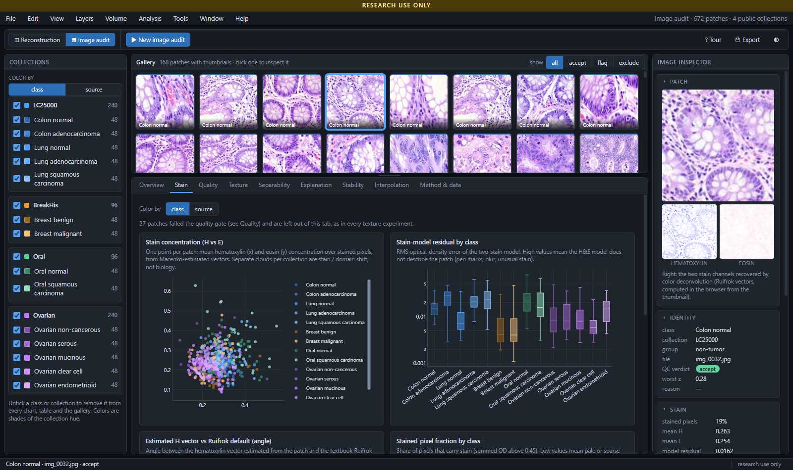
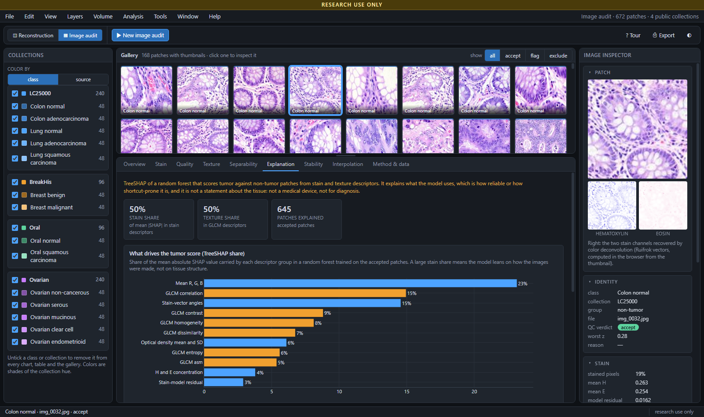

# VeriSection

**An open research workstation for auditing image evidence and descriptor reliability in digital pathology.**

> **Research use only. Not a medical device. Not for diagnosis, prognosis or treatment decisions.**

VeriSection keeps the provenance, quality and repeatability of image evidence attached to the result it supports. It is a Python package with a browser-based workstation that:

- labels every pixel or voxel as *observed*, *interpolated* or *synthetic*, and refuses exports that would drop the label;
- audits stain, image quality (focus, noise, padding) and the repeatability of texture descriptors, with a visible quality gate that keeps every exclusion and its reason;
- measures how much texture is changed by interpolation between sections;
- explains which descriptor groups drive a model (grouped permutation importance and TreeSHAP);
- maps an evidence vector to a report, caveat or abstain decision under a stated risk level.

The software accompanies the paper *VeriSection: an open research workstation for auditing image evidence and descriptor reliability in digital pathology* (submitted to PLOS Digital Health).

## Findings in the paper

Evaluated on public hematoxylin and eosin patches from four collections (672 patches, then a pool of 2,188 patches with five classifiers and pretrained features):

- Stain and texture descriptors identify the collection (balanced accuracy up to 0.98) and the organ (up to 0.99) of a patch much better than its tumor status (up to 0.85), whatever the classifier.
- A tumor model trained on three collections and tested on the fourth reaches a mean AUROC of 0.44 (stain and texture descriptors) or 0.58 (pretrained features), and color normalization does not help.
- The quality gate excludes 3.7% of the pool, unevenly across classes, and moves no balanced accuracy by more than 0.02; an explanation of the tumor model attributes 57% of its weight to stain descriptors.
- Texture descriptors are repeatable at a 2-pixel offset except under blur, and linear interpolation between independent sections lowers texture contrast by about 42% at the midpoint.

These results are descriptive; they come from independent two-dimensional patches and characterize image evidence.

## Install

Python 3.10 or newer.

```bash
git clone https://github.com/abidhasanrafi/verisection.git
cd verisection
pip install -e ".[test,viz,explain]"
verisection version
```

| Extra | Adds |
|---|---|
| `viz` | matplotlib (figures) |
| `explain` | `shap`, needed for the Explanation tab and per-patch explanations |
| `test` | pytest |

## Quick start

**Audit a folder of patches** (one sub-folder per class; see [Data](#data)) and open the result in the workstation:

```bash
verisection audit datasets --per-class 16 --out runs/audit.html
```



**Start the workstation** (local server on 127.0.0.1; nothing leaves the computer):

```bash
verisection ui                      # File > New image audit..., File > New simulation...
verisection simulate                # one tissue simulation -> standalone HTML that opens offline
verisection view3d runs/volume.npz  # open an exported volume in the workstation
```

The workstation has two workspaces that share one shell: **Reconstruction** (serial sections to a 3D volume with provenance and uncertainty) and **Image audit** (independent 2D patches: stain, quality, texture, separability, explanation, stability, interpolation bias). *Help > Guided tour* explains every region; the full guide with screenshots is [docs/UI_GUIDE.md](docs/UI_GUIDE.md).



### Command-line reference

| Command | Purpose |
|---|---|
| `verisection audit ROOT` | Audit independent 2D patches (stain, quality, texture, stability, interpolation bias, explanation) |
| `verisection ui` | Start the workstation with a local server |
| `verisection simulate` | Run one simulation and write a standalone workstation |
| `verisection view3d FILE` | Open an exported volume (with provenance) in the workstation |
| `verisection run-stack DIR` | Reconstruct a folder of section images; writes volume, manifest and HTML report |
| `verisection stain-qc DIR` | Per-section stain-vector diagnostics and drift flags |
| `verisection real-eval DIR` / `real-conformal DIR` | Hold-out interpolation test and blocked conformal check on a dense real stack (proxy truth) |
| `verisection demo` / `experiments` | Synthetic smoke run and multi-replicate synthetic experiments |
| `verisection plan` | Prospective planner: smallest uniform design meeting a target uncertainty |
| `verisection qc FILE` | Rule-based section QC on a stack saved as `.npy` |

`run-stack` reads one image per section in natural filename order and **assumes the section spacing equals the thickness** unless `--spacing-um` is given; the report says so.

### Python example

```python
from verisection.simulate import make_phantom, virtual_sections, SectioningConfig
from verisection.variogram import estimate_class_params
from verisection.pipeline import run_pipeline

truth = make_phantom(seed=0)
stack = virtual_sections(truth, SectioningConfig.hard(), seed=0)    # rotation, non-rigid deformation, stain shift
xi = estimate_class_params(truth, 2.0, 3)["xi_um"]                   # simulation only; real data: a dense pilot block
res = run_pipeline(stack, xi_um=xi, n_reg=4, n_seg=4, registration_method="nonrigid", sigma_scale=2.2)
res.maps.u_total, res.maps.provenance    # entropy (bits); 1 observed / 2 interpolated / 0 unsampled
res.export("out/volume.npz")             # refuses without provenance and manifest
```

## Modules

| Layer | Modules |
|---|---|
| Provenance and manifest | `provenance`, `volume`: every voxel is observed, interpolated, unsampled or synthetic; the manifest records what ran |
| Input safety | `validate`, `io`: actionable errors for blank, short or small input; hardened zip extraction |
| Registration | `register`, `transform`: translation, rigid and non-rigid chains with an ensemble by perturbation and failed-pair detection |
| Segmentation | `segment`: intensity-mixture ensemble with an interface for real models |
| Interpolation | `interpolate`, `reconstruct`, `variogram`: nearest, linear and indicator kriging with class correlation lengths |
| Uncertainty | `uncertainty`, `metrics`, `evaluate`, `conformal`: Monte Carlo propagation, entropy split, calibration metrics, split-conformal sets |
| Stain and quality | `stain`, `qc`: optical density, Ruifrok deconvolution, Macenko-style vectors, focus, noise, robust-z gate |
| Texture | `texture`: physical-scale GLCM with fixed optical-density bins, observed-support masks, ICC certification |
| Image audit | `imageaudit`: sampling, descriptors, gate, separability, transfer, stability, interpolation bias, explanation |
| Decisions | `decision`, `planner`: evidence vector to report, caveat or abstain; kriging section planner |
| Experiments | `experiments`, `stats`, `real_eval`, `simrun`, `simulate`, `tissue`: synthetic phantoms with known truth, replicate runs, real-stack hold-out |
| Output | `workstation`, `web/`, `analysis`, `report`, `viewer3d`, `viewer`: browser workstation, HTML reports |

## Data

The image audit expects a folder with one sub-folder per class. The paper uses four public collections:

| Collection | Source | Class folders |
|---|---|---|
| LC25000 | <https://github.com/tampapath/lung_colon_image_set> | `colon_n`, `colon_aca`, `lung_n`, `lung_aca`, `lung_scc` |
| BreakHis | <https://web.inf.ufpr.br/vri/databases/breast-cancer-histopathological-database-breakhis/> | `breast_benign`, `breast_malignant` |
| Oral cavity | <https://data.mendeley.com/datasets/ftmp4cvtmb/2> | `oral_normal_oral_cavity`, `oral_oscc` |
| Ovarian cancer and subtypes | <https://data.mendeley.com/datasets/kztymsrjx9/1> | `ovarian_non_cancerous`, `ovarian_serous`, `ovarian_mucinous`, `ovarian_clear_cell`, `ovarian_endometri` |

Files whose names start with `aug_` are augmented copies and are never sampled. The images are not redistributed here; download them from the sources above and place the class folders under `datasets/` (ignored by git). Real data are untrusted input: archives are extracted with traversal, symlink and size guards, and scripts that read downloaded data should be run with `python -I`.

## Repository layout

```
src/verisection/   the package (core, CLI, workstation front end in web/)
tests/             pytest suite (browser tests run only when Edge or Chrome is found)
docs/              UI guide and screenshots
tools/             interface screenshot and export self-test helpers
```

## Tests

```bash
pip install -e ".[test,viz,explain]"
pytest
```

The suite covers reconstruction, calibration, texture and decisions, the workstation (including layout and exports in a headless browser) and the image audit. Browser tests are skipped when no Edge or Chrome installation is found, and the explanation tests are skipped without `shap`.

## Status and limitations

Version `0.1.0.dev0` is early research software. The image-audit workspace is evaluated on real public patches; the reconstruction layers are validated mainly on synthetic phantoms with known ground truth, which check that the machinery behaves as designed, and on one public serial-section stack with a proxy truth. The segmentation baseline is an intensity mixture and registration is two-dimensional and sequential. Whole-slide formats are not supported yet. Pixel size is absent from the public patch collections, so all texture scales there are in pixels.

## Citation

Please cite the software and the paper; see [`CITATION.cff`](CITATION.cff).

## License

Released under the MIT License; see [LICENSE](LICENSE).
