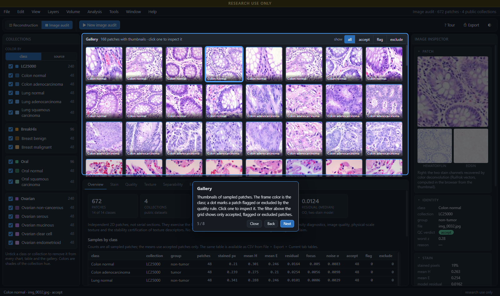

# VeriSection Workstation: user interface guide

> **Research use only.** Not a medical device. Nothing in the interface is a diagnosis, a prognosis or a treatment recommendation.

The workstation is one browser application with **two workspaces** that share the same shell:

| Workspace | Input | What it is for | Start it |
|---|---|---|---|
| **Reconstruction** | serial sections (or the built-in tissue phantom) | a 3D volume in which every voxel is labeled *observed*, *interpolated* or *synthetic* and carries its uncertainty | `verisection ui`, then *File ▸ New simulation…*; or `verisection simulate` |
| **Image audit** | folders of independent 2D patches | stain, image quality, physical-scale texture, descriptor stability, and what interpolation does to texture | `verisection ui`, then *File ▸ New image audit…*; or `verisection audit DATASET_DIR` |

The workspace is switched with the control at the left of the toolbar (*Reconstruction | Image audit*) or with *View ▸ Workspace*.
**Help ▸ Guided tour** (or the *? Tour* button) highlights every region in turn and says what it is for.

## 1. The shell (common to both workspaces)

| # | Region | What it does |
|---|---|---|
| 1 | **Banner** | The words *RESEARCH USE ONLY*. The full intended-use statement and the known limits are under *Help ▸ Intended use and limitations*. |
| 2 | **Menubar** | *File* (new run, export), *Edit*, *View* (workspace, layout, theme), *Layers*, *Volume*, *Tools* (reconstruction only), *Analysis* (one entry per tab), *Window*, *Help*. Every menu item that needs data is greyed out until data is loaded. |
| 3 | **Toolbar** | Workspace switch, the run button, tools, layout, overlays; on the right the tour, image export and light/dark theme. Controls that do not apply to the current workspace are hidden, not disabled. |
| 4 | **Left dock** | *Layers* (reconstruction) or *Collections* (audit). |
| 5 | **Center** | Linked slice views and the 3D view (reconstruction) or the patch gallery (audit). |
| 6 | **Right dock** | *Inspector* (voxel under the crosshair) or *Image inspector* (selected patch). |
| 7 | **Analysis dock** | One tab per question. Every chart has a one-line “how to read this”; tables export to CSV. Drag the handle above it to resize (*Analysis ▸ Dock height*). |
| 8 | **Status bar** | The last action, the cursor or selected patch, and the research-use reminder. Script errors are shown here rather than swallowed. |

Design rules, enforced by tests: panels are separated by a fixed gap; nothing is clipped at 1280 px and wider; there are **no sliders** (opacity uses presets, slices use steppers, everything else uses selects).

## 2. Image audit workspace

### 2.1 Collections (left dock)

One card per public collection with its classes. A checkbox removes a class (or a whole collection) from the gallery, from every chart and from every table. *Color by* switches between class shades (each class is a shade of its collection’s hue) and collection hues.

### 2.2 Gallery (center)

Thumbnails of the sampled patches. The frame color is the class. A dot in the corner means the patch **failed the quality gate** (hover for the reason). The *show* control filters to accepted, flagged or excluded patches. Click a thumbnail to inspect it. (Thumbnails are kept for the first 12 patches of each class to keep the file small; the tables and charts use every patch.)

### 2.3 Image inspector (right dock)

The selected patch, and next to it its **hematoxylin and eosin channels** recovered by color deconvolution in the browser (Ruifrok vectors), then its identity, quality verdict and reason, stain numbers, quality numbers and five texture numbers. Cards collapse and remember their state.

### 2.4 Tabs

| Tab | Question it answers | How to read it | Watch out for |
|---|---|---|---|
| **Overview** | What is in the sample? | Counts, median stained fraction, how many patches failed the gate, a per-class table. | The means use accepted patches only; the counts include everything. |
| **Stain** | Do the collections look different before any model sees them? | H–E scatter (one point per patch), stain-model residual, angle between the estimated H vector and the textbook Ruifrok vector, stained-pixel fraction. Clicking a point selects the patch. | Separate clouds are stain or scanner differences, not biology. |
| **Quality** | Which patches should not be analysed? | Focus (variance of Laplacian) against noise (Haar), and the share accepted / flagged / excluded per collection. The table lists the worst patches with the reason. | The hard rule (more than 2 % black pixels) exists because letterbox padding makes stain and noise numbers meaningless. The soft rule is a robust z-score (flag above 3.5, exclude above 6) and has not been validated against downstream failure. |
| **Texture** | What does the texture of each class look like? | PCA of the 24 GLCM descriptors, and any one descriptor by class. | Scales are in **pixels**: these collections do not record pixel size. Grey levels are fixed 0.05-OD bins with a fixed white point, so values are comparable across patches. |
| **Separability** | Do the descriptors carry tissue-type signal, and how much of it is specific to one collection? | Cross-validated accuracy for four label sets; AUROC for tumor vs non-tumor *inside* a collection (blue) and *trained on the other three* (orange). A large gap is **domain shift**. | This characterizes the descriptors. It is **not diagnostic performance**. LC25000 patches are augmentations of fewer originals, so its in-source result can be optimistic. |
| **Explanation** | Which descriptor groups does a tumor model lean on? | TreeSHAP share of each group (stain in blue, texture in orange) for a random forest trained on the accepted patches; the inspector adds the three largest contributions to the selected patch's score. | It explains the **model**, not the tissue, and it is not a diagnosis. A model that leans mostly on stain color is probably recognizing the collection. Needs the optional `shap` package. |
| **Stability** | Which descriptors can be trusted? | Lower 95 % bound of ICC(2,1) across noise, blur and optical-density perturbations; green = certified (≥ 0.75). | A descriptor that is not certified should not support a quantitative claim without recalibration. |
| **Interpolation** | What does gap-filling do to texture? | Relative bias of each descriptor in an interpolated plane (0 = an observed plane). Choose independent neighbors or neighbors shifted by 4 or 12 px. | Real texture, **simulated** sectioning. This is the reason interpolated voxels are masked out of texture features. |
| **Method & data** | What exactly was run? | The procedure, the limits, and the four source datasets with their references. | |

### 2.5 The quality gate

Every audit starts with the gate. Patches that fail it are **reported, not silently dropped**: they stay in the gallery and in the Quality tab with the reason, but they are left out of every statistic in the other tabs. In the bundled sample, 27 of 672 patches (4 %) fail, 21 of them *ovarian serous* files that are whole-slide overviews with black letterbox padding (noise σ = 0, hematoxylin > 3 OD before the gate).

## 3. Reconstruction workspace

| Region | Notes |
|---|---|
| **Views** | Axial, coronal and sagittal slices with one shared crosshair, and a WebGL2 ray-marched 3D view (six render modes). Scroll changes plane; drag orbits the 3D view. The ruler beside the axial view shows which planes were observed and which were interpolated. Orange hatching always means *interpolated: model inference, not observation*. |
| **Layers** | Image, segmentation, uncertainty (entropy), provenance, truth contour and error map (simulations), registration variance. Visibility and opacity presets per layer. |
| **Inspector** | Provenance, predicted class, entropy, class posterior bars, distance to the nearest observed section; region-of-interest statistics; 3D distance in µm. |
| **Tabs** | Summary, Segmentation, Calibration, Uncertainty, Registration, Sections QC, Texture, Measurements, Planner, Conformal (optional), Provenance, Manifest. |

## 4. Exporting

* **Images**: *File ▸ Export image…* (`Ctrl+Shift+E`) at 300, 600, 900 or 1200 dpi. Charts are re-rendered at the target size, not enlarged; the dpi is written into the PNG. Every export except the full window carries a research-use caption. *Analysis: charts of the current tab* gives a ZIP with PNG, SVG and the tab’s tables as CSV.
* **Data**: *File ▸ Export ▸ Current tab tables (CSV)*, *Analysis (JSON)* and *Summary (TXT)* work in both workspaces.
* **Print**: `Ctrl+P` prints the current analysis tab without the chrome.

## 5. Keyboard

`Ctrl+N` new simulation · `Ctrl+Shift+A` new image audit · `Ctrl+Shift+E` export image · `?` all shortcuts · `Esc` closes menus, dialogs and the tour · `←` `→` move through the tour. Reconstruction views: `C` `D` `R` tools, `1`–`4` active view, `[` `]` previous / next observed plane, `U` `P` `G` `F` overlays, `M` render mode, `A` auto-rotate, `L` layout.
